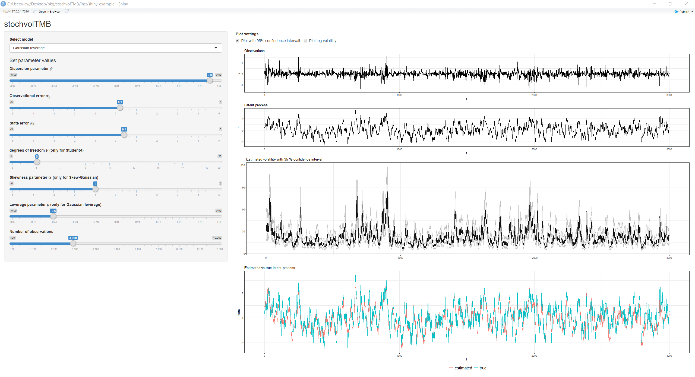

<!-- README.md is generated from README.Rmd. Please edit that file -->

```{r, include = FALSE}
knitr::opts_chunk$set(
  collapse = TRUE,
  comment = "#>",
  fig.path = "man/figures/README-",
  out.width = "100%",
  dev = "ragg_png",
  dpi = 300
)
```

# stochvolTMB

<!-- badges: start -->
[](https://cran.r-project.org/package=stochvolTMB)
[](https://r-pkg.org/pkg/stochvolTMB)
[](https://github.com/JensWahl/stochvolTMB/actions)
[](https://www.gnu.org/licenses/gpl-3.0)
[](https://lifecycle.r-lib.org/articles/stages.html)
[](https://zenodo.org/badge/latestdoi/162462958)
<!-- badges: end -->

`stochvolTMB` is a package for fitting stochastic volatility (SV) models to time series data. It is inspired by the package [stochvol](https://github.com/gregorkastner/stochvol), but parameter estimates are obtained through optimization and not MCMC, leading to significant speed up. It is built on [Template Model Builder](https://github.com/kaskr/adcomp) for fast and efficient estimation. The latent volatility is integrated out of the likelihood using the Laplace approximation and automatic differentiation (AD) is used for accurate evaluation of derivatives. 

Seven models for the observational error are implemented. Select a model with the `model` argument of `estimate_parameters`: 

* **Gaussian** (`"gaussian"`) - The classic SV model with Gaussian noise 
* **t** (`"t"`) - t-distributed noise for heavy tail returns 
* **Leverage** (`"leverage"`) -  Extending the **Gaussian** model by allowing observed returns to be correlated with the latent volatility
* **Skew-Gaussian** (`"skew_gaussian"`) - Skew-Gaussian distributed noise for asymmetric returns
* **Skew-Gaussian with leverage** (`"skew_gaussian_leverage"`) - Combines asymmetric returns with the leverage effect
* **Skew-t** (`"skew_t"`) - Skew t distributed noise with separate degrees of freedom for the left and the right tail
* **Skew-t with leverage** (`"skew_t_leverage"`) - Combines heavy and asymmetric tails with the leverage effect


## Installation
To install the current stable release from CRAN, use

```{r eval = FALSE}
install.packages("stochvolTMB")
```

To install the current development version, use

``` {r eval = FALSE}
# install.packages("remotes")
remotes::install_github("JensWahl/stochvolTMB")
```

If you would also like to build and view the vignette locally, use

```{r, eval = FALSE}
remotes::install_github("JensWahl/stochvolTMB", dependencies = TRUE, build_vignettes = TRUE)
```

## Example

The main function for estimating parameters is `estimate_parameters`:

```{r example, fig.alt = c("Estimated volatility of the S&P 500 with a 95% confidence interval", "S&P 500 returns with the 95% interval from the skew-t leverage model")}
library(stochvolTMB, warn.conflicts = FALSE)

# load s&p500 data from 2005 to 2018
data(spy)

# fit all seven models and rank them by AIC
comparison <- compare_models(spy$log_return)
comparison[, .(model, n_par, log_lik, aic, bic, delta_aic, converged)]

# the fitted models are stored in the attribute "fits"
fits <- attr(comparison, "fits")
leverage <- fits$leverage
skew_gaussian_leverage <- fits$skew_gaussian_leverage
skew_t_leverage <- fits$skew_t_leverage

# parameter estimates on their natural scale, with standard errors
coef(skew_t_leverage)
sqrt(diag(vcov(skew_t_leverage)))

# the skew models report the skewness and the shape parameter alpha
summary(skew_gaussian_leverage, report = "transformed")

# get parameter estimates with standard error
estimates <- summary(leverage)
head(estimates, 10)

# plot estimated volatility with 95 % confidence interval
plot(leverage, include_ci = TRUE, dates = spy$date)

# plot the returns with the 95 % interval of the fitted model
plot_returns(skew_t_leverage, dates = spy$date)


```

Given the estimated parameters we can simulate future volatility and log-returns using `predict`. 
```{r fig.alt = "Estimated and predicted volatility of the S&P 500 for the next 50 days"}
set.seed(123)
# simulate future prices with or without parameter uncertainty
pred = predict(leverage, steps = 10)

# Calculate the mean, 2.5% and 97.5% quantiles from the simulations
pred_summary = summary(pred, quantiles = c(0.025, 0.975), predict_mean = TRUE)

print(pred_summary)

# plot predicted volatility with 0.025 and 0.975 quantiles
plot(leverage, include_ci = TRUE, forecast = 50, dates = spy$d) +
  ggplot2::xlim(c(spy[.N, date] - 150, spy[.N, date] + 50))

```

To check the fit with one-step-ahead residuals, use `plot_diagnostics`. It shows a Q-Q plot and the autocorrelation of the residuals and of the squared residuals:

```{r fig.height=3.5, fig.alt = "Q-Q plot and autocorrelation of the one-step-ahead residuals of the skew-t leverage model"}
plot_diagnostics(skew_t_leverage)
```

## Value at Risk and Expected Shortfall

`var_es` calculates the one-day Value at Risk (VaR) and Expected Shortfall (ES) from the exact one-step-ahead predictive distribution, for every day in the data and for the next day. `backtest_var` tests if the VaR exceedances have the expected frequency (Kupiec) and are independent (Christoffersen). For the S&P 500 data, the skew-t model with leverage passes both tests at the 95% and 99% levels:

```{r fig.height=4, fig.alt = "S&P 500 returns with the one-step-ahead 99% VaR and ES from the skew-t leverage model, with the exceedances marked"}
risk <- var_es(skew_t_leverage, level = c(0.95, 0.99))

# VaR and ES for the next day
risk[is.na(y)]

backtest_var(risk)

plot_var(risk, level = 0.99, dates = spy$date)
```

For more than one day, `forecast_var_es` simulates future returns. The cumulative columns give, for example, the 10-day VaR and ES:

```{r}
set.seed(123)
forecast_var_es(skew_t_leverage, steps = 10, level = 0.99)[c(1, 5, 10)]
```

## Shiny app 

By running `run_shiny_demo()` you start a shiny application where you can visually inspect the effect of choosing different models and parameter configurations 

```{r eval = FALSE}
run_shiny_demo()
```


