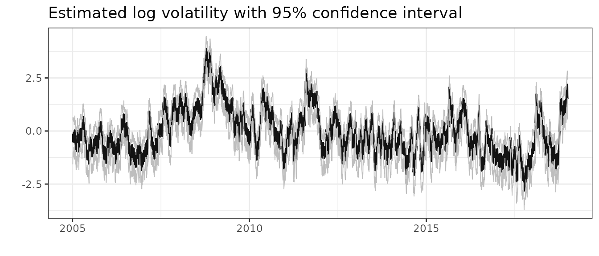
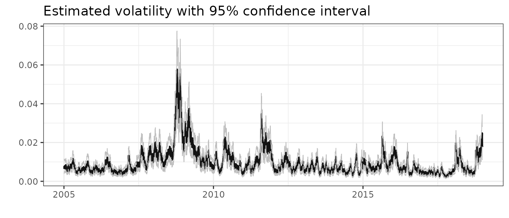
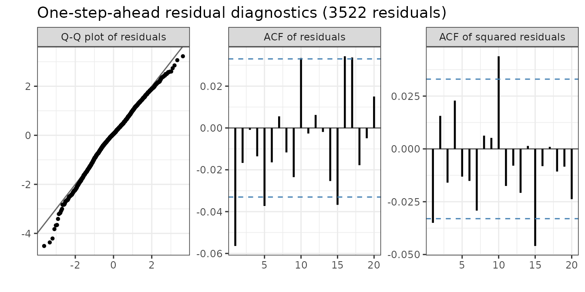
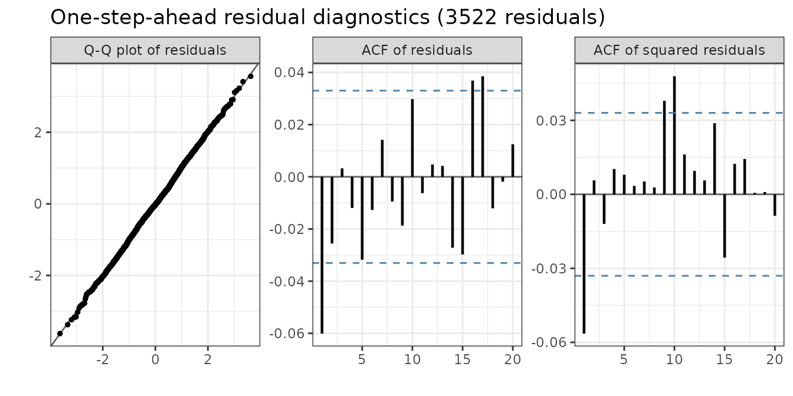
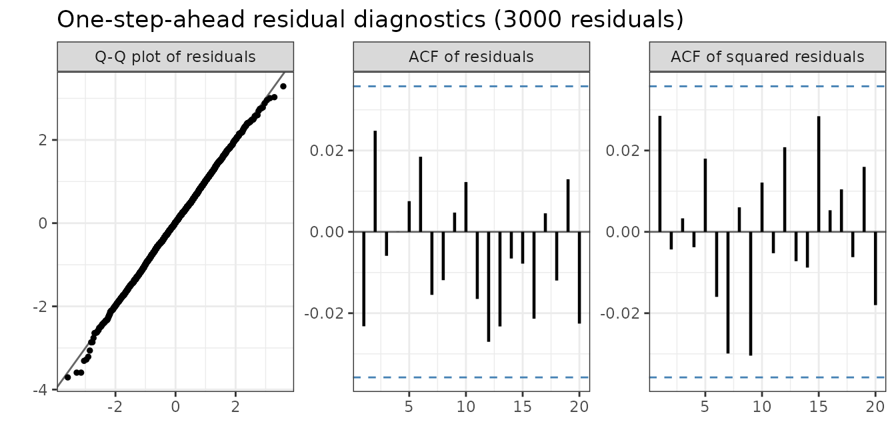

# stochvolTMB: Likelihood estimation of stochastic volatility

## The stochastic volatility model

The stochastic volatility model, introduced by Taylor (1982), is defined
by \\\begin{equation} \begin{aligned} y_t &= \sigma_y e^{h_t/2}
\epsilon_t, \quad t = 1, \dots, T, \\ h\_{t+1} &= \phi h\_{t} + \sigma_h
\eta_t, \quad t = 1, \dots, T-1, \\ \eta_t &\stackrel{\text{iid}}{\sim}
\mathcal{N}(0,1), \\ \epsilon_t &\stackrel{\text{iid}} {\sim} F
\end{aligned} \end{equation}\\ where \\y_t\\ is the observed log
returns, \\h_t\\ is the logarithm of the variance on day \\t\\. The
distribution of the innovations \\\epsilon_t\\ is specified below. To
ensure stationarity for \\h_t\\, we assume \\\|\phi\| \< 1\\. It can be
shown that the unconditional distribution of \\h_t\\ is
\\\mathcal{N}(0,\sigma_h^2/(1 - \phi^2))\\, and we assume \\h_1 \sim
\mathcal{N}(0,\sigma_h^2/(1-\phi^2))\\. An interpretation of the latent
process \\\\h_t\\\\ is that is represents the random and uneven flow of
new information into the marked. For different time points, the variance
will be dependent of this unobserved \`\`flow’’ of information,
i.e. conditioning on \\h_t\\, \\\mathrm{Var}(y_t \| h_t) = \sigma_y^2
e^{h_t}\\.

The original SV model from Taylor (1982) assumed normally distributed
innovations, but this is usually to strong of an assumption. Financial
returns are usually heavy-tailed, might be asymmetric and the volatility
can be correlated with the returns. The latter is called the *leverage
effect*, where there is a negative correlation between a change in price
and the volatility, meaning that a drop in price tend to lead to an
increase in volatility To take these features of financial time series
into account `stochvolTMB` has implemented the following seven models
for the innovations:

- Gaussian: \\\epsilon_t \sim \mathcal{N}(0,1)\\
- t: \\\epsilon_t \sim t\_\nu(0,1)\\, where \\\nu\\ is the degrees of
  freedom.
- Skew-Gaussian: \\\epsilon_t \sim \mathcal{SN}(0,1, \alpha)\\, with
  zero mean, unit variance and shape parameter \\\alpha\\. See [Skewness
  and the shape parameter](#skewness-and-the-shape-parameter) for how
  the asymmetry is estimated and reported.
- Leverage: \\\epsilon_t \sim \mathcal{N}(0,1)\\ and
  \\\mathrm{Cor}(\epsilon_t, \eta_t) = \rho\\
- Skew-Gaussian with leverage: \\\epsilon_t \sim \mathcal{SN}(0,1,
  \alpha)\\ and \\\eta_t = \rho \epsilon_t + \sqrt{1 - \rho^2} e_t\\,
  where \\e_t \sim \mathcal{N}(0,1)\\ is independent of \\\epsilon_t\\.
  Then \\\mathrm{Cor}(\epsilon_t, \eta_t) = \rho\\, and the returns have
  the same skewness as in the skew-Gaussian model. With \\\alpha = 0\\
  this is the leverage model.
- Skew-t: \\\epsilon_t\\ has the skew t distribution of Jones and Faddy
  (2003), scaled to zero mean and unit variance. Its density is
  proportional to \\(1 + x/\sqrt{a + b + x^2})^{a + 1/2} (1 -
  x/\sqrt{a + b + x^2})^{b + 1/2}\\ before scaling. The left tail decays
  like a t-distribution with \\\nu_L = 2a\\ degrees of freedom, and the
  right tail like one with \\\nu_R = 2b\\. With \\\nu_L \< \nu_R\\,
  large losses are more likely than large gains, which is common for
  stock returns. With \\\nu_L = \nu_R\\ this is the t model.
- Skew-t with leverage: \\\epsilon_t\\ has the skew t distribution
  above, and \\\eta_t = \rho \epsilon_t + \sqrt{1 - \rho^2} e_t\\ as in
  the skew-Gaussian model with leverage. This combines heavy and
  asymmetric tails with the leverage effect.

### Skewness and the shape parameter

The skew-Gaussian models report two numbers for the asymmetry of
\\\epsilon_t\\: the shape parameter `alpha` and the `skewness`. Both
describe the same distribution on different scales.

The shape parameter \\\alpha\\ is the parameter of the skew-normal
density. With location \\\xi\\ and scale \\\omega\\ chosen so that
\\\epsilon_t\\ has mean zero and unit variance, the density is \\ p(x) =
\frac{2}{\omega} \phi\left(\frac{x - \xi}{\omega}\right)
\Phi\left(\alpha \frac{x - \xi}{\omega}\right), \\ where \\\phi\\ and
\\\Phi\\ are the density and the distribution function of the standard
Gaussian distribution. \\\alpha = 0\\ gives the Gaussian distribution,
and \\\alpha \to \pm \infty\\ gives a half-Gaussian distribution.
\\\alpha\\ has no direct statistical meaning.

The skewness \\\gamma_1 = \mathrm{E}\[\epsilon_t^3\]\\ is the usual
skewness coefficient, because \\\epsilon_t\\ has mean zero and unit
variance. It is a monotone function of \\\alpha\\: \\ \delta =
\frac{\alpha}{\sqrt{1 + \alpha^2}}, \qquad \mu = \delta \sqrt{2 / \pi},
\qquad \gamma_1 = \frac{4 - \pi}{2} \frac{\mu^3}{(1 - \mu^2)^{3/2}}. \\

| \\\alpha\\   | 0   | 0.5  | 1    | 2    | 5    | 27   | \\\infty\\ |
|--------------|-----|------|------|------|------|------|------------|
| \\\gamma_1\\ | 0   | 0.02 | 0.14 | 0.45 | 0.85 | 0.99 | 0.995      |

`stochvolTMB` estimates the skewness, not \\\alpha\\, for two reasons:

- Close to zero, \\\gamma_1\\ grows like \\\alpha^3\\. The likelihood is
  therefore flat in \\\alpha\\ at \\\alpha = 0\\ (the first and second
  derivatives are zero), and an optimizer that starts there does not
  move. In the skewness, the likelihood has a normal slope at zero.
- Large values of \\\alpha\\ change the distribution very little. The
  skewness is bounded by \\\|\gamma_1\| \< 0.99\\, which corresponds to
  \\\|\alpha\| \le 27\\. This keeps the optimizer away from the
  half-Gaussian limit, where the fit is unstable.

The skewness is estimated on a transformed scale as `logit_skewness`.
`summary(object, report = "transformed")` reports `skewness` and `alpha`
with standard errors from the delta method. Use `skewness` for
inference. Use `alpha` when you need the shape parameter, for example in
`sim_sv`, [`sn::dsn`](https://rdrr.io/pkg/sn/man/dsn.html) or other
software. When the skewness is close to zero, a small change in skewness
gives a large change in \\\alpha\\, so the standard error of `alpha` is
very large even when the skewness is well determined.

In the skew-Gaussian model with leverage, the skewness is that of the
return shock \\\epsilon_t\\, not of the returns \\y_t\\. The
time-varying volatility, and its correlation with past shocks, change
the distribution of \\y_t\\.

`stochvolTMB` is inspired by the package
[stochvol](https://github.com/gregorkastner/stochvol) (Kastner (2016)),
but `stochvolTMB` obtain parameter estimates through maximum likelihood
estimation and not Markov Chain Monte Carlo.

## Usage

The main functions of `stochvolTMB` are:

| Function Name | Description |
|:---|:---|
| `estimate_parameters` | Estimate parameters of a stochastic volatility model. |
| `sim_sv` | Simulate data from a stochastic volatility model. |
| `plot.stochvolTMB` | Plot estimated volatility and predicted (with confidence intervals). |
| `summary.stochvolTMB` | Extract parameter estimates and volatility with uncertainty. |
| `predict.stochvolTMB` | Predict future volatility and returns. |
| `plot_returns` | Plot returns with intervals from the fitted model. |
| `residuals` | Calculate one-step-ahead residuals. |
| `plot_diagnostics` | Plot diagnostics based on one-step-ahead residuals. |
| `compare_models` | Fit several models and rank them by AIC. |
| `coef`, `vcov` | Parameter estimates and their covariance matrix. |
| `var_es` | One-day Value at Risk and Expected Shortfall. |
| `forecast_var_es` | Value at Risk and Expected Shortfall for several days. |
| `backtest_var` | Backtest the Value at Risk. |
| `plot_var` | Plot returns with the Value at Risk and Expected Shortfall. |

`estimate_parameters` returns an object of class `stochvolTMB`. The
`summary` function returns a `data.table` with estimated parameters,
estimated log-volatility and transformed parameters along with standard
errors, p-values and z-values. The argument `report = "fixed"` returns
the parameters on the scale they were estimated. This means that the
standard deviations \\\sigma_y, \sigma_h\\ are given on the log scale;
the degrees of freedom is one the scale \\\log (\nu - 2)\\ to ensure
that \\\nu \> 2\\ (i.e. the variance exists); and lastly that the
persistence parameter \\\phi\\ and the correlation parameter \\\rho\\
are estimated on a logit scale to ensure that they are between -1 and 1.
If `report = c("fixed", "transformed")`, parameter estimates transformed
back to their original scale is also returned. If you want to extract
the estimated log-volatility you can use `report = "random"`.

## Example

Estimating parameters in a SV model is easy with `stochvolTMB`. As an
example we investigate the daily log-returns of the S&P500 from 2005 to
2018. A quick look at the data:

``` r

data(spy)
plot(spy$date, spy$log_return, type = "l", xlab = "", ylab = "", main = "Log-returns of S&P500")
```


``` r

plot(spy$date, spy$price, type = "l", xlab = "", ylab = "", main = "Price of S&P500")
```


We fit all seven models with `compare_models`. It calls
`estimate_parameters` for each model and stores the fitted models in the
attribute `"fits"`. To fit one model, use
`estimate_parameters(spy$log_return, model = "leverage")`.

``` r

comparison <- compare_models(spy$log_return)
fits <- attr(comparison, "fits")
gaussian <- fits$gaussian
t_dist <- fits$t
skew_gaussian <- fits$skew_gaussian
leverage <- fits$leverage
skew_gaussian_leverage <- fits$skew_gaussian_leverage
skew_t <- fits$skew_t
skew_t_leverage <- fits$skew_t_leverage
```

We can investigate the estimate for the degrees of freedom (`df`) to see
if the returns are heavy-tailed

``` r

summary(t_dist, report = "transformed")
#>    parameter     estimate    std_error    z_value      p_value        type
#>       <char>        <num>        <num>      <num>        <num>      <char>
#> 1:   sigma_y  0.008392879 0.0008689248   9.658924 4.505714e-22 transformed
#> 2:   sigma_h  0.185766767 0.0182175649  10.197124 2.042308e-24 transformed
#> 3:       phi  0.984924644 0.0039281816 250.732972 0.000000e+00 transformed
#> 4:        df 10.086366735 2.1022435031   4.797906 1.603330e-06 transformed
```

Clearly the returns are more heavy tailed than Gaussian, even when
controlling for the stochastic volatility. We can also check for
asymmetric returns

``` r

summary(skew_gaussian, report = "transformed")
#>    parameter     estimate    std_error    z_value      p_value        type
#>       <char>        <num>        <num>      <num>        <num>      <char>
#> 1:   sigma_y  0.008247888 0.0007528397  10.955703 6.239188e-28 transformed
#> 2:   sigma_h  0.210904249 0.0187693205  11.236648 2.694187e-29 transformed
#> 3:       phi  0.980555386 0.0044991195 217.943839 0.000000e+00 transformed
#> 4:  skewness -0.164420269 0.0452041263  -3.637285 2.755275e-04 transformed
#> 5:     alpha -1.088785163 0.1427623077  -7.626559 2.411026e-14 transformed
```

and leverage (`rho`)

``` r

summary(leverage, report = "transformed")
#>    parameter     estimate    std_error   z_value       p_value        type
#>       <char>        <num>        <num>     <num>         <num>      <char>
#> 1:   sigma_y  0.008338412 0.0004163314  20.02830  3.121144e-89 transformed
#> 2:   sigma_h  0.273443559 0.0182641070  14.97164  1.125191e-50 transformed
#> 3:       phi  0.967721215 0.0043681868 221.53842  0.000000e+00 transformed
#> 4:       rho -0.748695259 0.0322487815 -23.21623 3.121690e-119 transformed
```

There is clear evidence for both asymmetric returns and a negative
correlation (of -0.74!) between log-returns and the volatility.

We can also check if combining skewness and leverage provides a better
fit:

``` r

summary(skew_gaussian_leverage, report = "transformed")
#>    parameter    estimate    std_error   z_value       p_value        type
#>       <char>       <num>        <num>     <num>         <num>      <char>
#> 1:   sigma_y  0.00795118 0.0003805306  20.89498  5.948316e-97 transformed
#> 2:   sigma_h  0.27681170 0.0178393399  15.51693  2.665200e-54 transformed
#> 3:       phi  0.97101638 0.0038900968 249.61239  0.000000e+00 transformed
#> 4:  skewness -0.40469100 0.0391237338 -10.34387  4.461261e-25 transformed
#> 5:     alpha -1.82972879 0.1306960200 -13.99988  1.561309e-44 transformed
#> 6:       rho -0.83719989 0.0226025017 -37.04014 2.588099e-300 transformed
```

To find the model that fits the data best, we can compare the
[AIC](https://en.wikipedia.org/wiki/Akaike_information_criterion) of our
models and pick the smallest. `compare_models` returns the models ranked
by AIC. The columns `converged` and `pd_hessian` show if the optimizer
converged and if the Hessian is positive definite. If one of them is
`FALSE`, the estimates of that model are not reliable.

``` r

comparison[, .(model, n_par, log_lik, aic, bic, delta_aic, converged, pd_hessian)]
#>                     model n_par  log_lik       aic       bic delta_aic
#>                    <char> <int>    <num>     <num>     <num>     <num>
#> 1:        skew_t_leverage     6 11866.69 -23721.38 -23684.38   0.00000
#> 2: skew_gaussian_leverage     5 11854.30 -23698.59 -23667.76  22.78558
#> 3:               leverage     4 11808.43 -23608.85 -23584.18 112.52674
#> 4:                 skew_t     5 11734.86 -23459.72 -23428.89 261.65871
#> 5:                      t     4 11729.85 -23451.69 -23427.02 269.68665
#> 6:          skew_gaussian     4 11724.36 -23440.72 -23416.06 280.65545
#> 7:               gaussian     3 11718.29 -23430.57 -23412.07 290.80456
#>    converged pd_hessian
#>       <lgcl>     <lgcl>
#> 1:      TRUE       TRUE
#> 2:      TRUE       TRUE
#> 3:      TRUE       TRUE
#> 4:      TRUE       TRUE
#> 5:      TRUE       TRUE
#> 6:      TRUE       TRUE
#> 7:      TRUE       TRUE
```

The skew-t model with leverage has the smallest AIC. It estimates one
degree of freedom for each tail and the leverage \\\rho\\. The left tail
of the S&P 500 returns is clearly heavier than the right tail, and the
correlation between the return shock and the volatility shock is
strongly negative:

``` r

summary(skew_t_leverage, report = "transformed")
#>    parameter     estimate    std_error   z_value      p_value        type
#>       <char>        <num>        <num>     <num>        <num>      <char>
#> 1:   sigma_y  0.007960946 0.0003943647  20.18676 1.279770e-90 transformed
#> 2:   sigma_h  0.266050218 0.0179234176  14.84372 7.639754e-50 transformed
#> 3:       phi  0.975054402 0.0035924729 271.41593 0.000000e+00 transformed
#> 4:   df_left  8.633938213 1.5493998448   5.57244 2.511955e-08 transformed
#> 5:  df_right 15.174235582 3.7766675111   4.01789 5.872153e-05 transformed
#> 6:       rho -0.870746622 0.0201355143 -43.24432 0.000000e+00 transformed
```

`coef` and `vcov` return the estimates on their natural scale and their
covariance matrix. With `scale = "estimation"` they use the scale that
the parameters were estimated on:

``` r

coef(skew_t_leverage)
#>      sigma_y      sigma_h          phi      df_left     df_right          rho 
#>  0.007960946  0.266050218  0.975054402  8.633938213 15.174235582 -0.870746622
sqrt(diag(vcov(skew_t_leverage)))
#>      sigma_y      sigma_h          phi      df_left     df_right          rho 
#> 0.0003943647 0.0179234176 0.0035924729 1.5493998448 3.7766675111 0.0201355143
```

We can compare the leverage model with the skew-Gaussian leverage model
to see if adding skewness improves the fit.

The skew-Gaussian models report both `skewness` and the shape parameter
`alpha` (see [Skewness and the shape
parameter](#skewness-and-the-shape-parameter)). Use `skewness` for
inference. To simulate from the model, give `alpha` to `sim_sv`:

``` r

param <- list(phi = 0.95, sigma_h = 0.25, sigma_y = 0.01, alpha = -2, rho = -0.7)
sim <- sim_sv(param, nobs = 2000, seed = 1, model = "skew_gaussian_leverage")
fit <- estimate_parameters(sim$y, model = "skew_gaussian_leverage", silent = TRUE)
summary(fit, report = "transformed")
#>    parameter    estimate    std_error    z_value       p_value        type
#>       <char>       <num>        <num>      <num>         <num>      <char>
#> 1:   sigma_y  0.01032339 0.0003779026  27.317592 2.621825e-164 transformed
#> 2:   sigma_h  0.23428648 0.0242279181   9.670104  4.039682e-22 transformed
#> 3:       phi  0.93945634 0.0113655487  82.658248  0.000000e+00 transformed
#> 4:  skewness -0.49637925 0.0541021456  -9.174853  4.521893e-20 transformed
#> 5:     alpha -2.15955503 0.2114230961 -10.214376  1.709754e-24 transformed
#> 6:       rho -0.70745465 0.0576766555 -12.265875  1.381122e-34 transformed
```

Lastly, we can also plot the estimated log-volatility and volatility:

``` r

plot(leverage, include_ci = TRUE, plot_log = TRUE, dates = spy$date)
```



``` r

plot(leverage, include_ci = TRUE, plot_log = FALSE, dates = spy$date)
```



We can simulate future returns with `predict`. This function returns
three matrices of dimension \\\\\\ steps \\\times\\ \#\$ simulations:
(1) the latent log-volatility `h`; (2) one for the percentage volatility
`100 * sigma_y * exp(0.5 * h)` and (3) future returns. If the argument
`include_parameters` is set to `TRUE`, the fixed parameters are
simulated from their asymptotic multivariate distribution. This usually
leads to broader uncertainty bands. To summarize the output from
`predict`, we use the `summary` function, that calculate the mean and
different quantiles based on the sumulations. We use the leverage model
as an example:

``` r


pred = predict(leverage, steps = 10, include_parameters = TRUE)
summary(pred)
#> $y
#>      time quantile_0.025 quantile_0.975          mean
#>     <int>          <num>          <num>         <num>
#>  1:     1    -0.03390928     0.03578714  1.884305e-04
#>  2:     2    -0.03468329     0.03533891  1.936343e-04
#>  3:     3    -0.03399761     0.03578401  5.544499e-04
#>  4:     4    -0.03539847     0.03482133 -7.306338e-05
#>  5:     5    -0.03507907     0.03531515 -1.994870e-04
#>  6:     6    -0.03346930     0.03283918  3.510375e-05
#>  7:     7    -0.03382748     0.03325664 -6.717707e-05
#>  8:     8    -0.03510687     0.03489823  5.258260e-05
#>  9:     9    -0.03276020     0.03321078 -5.889527e-05
#> 10:    10    -0.03267239     0.03235914  7.830765e-05
#> 
#> $h
#>      time quantile_0.025 quantile_0.975     mean
#>     <int>          <num>          <num>    <num>
#>  1:     1     0.31931862       2.334532 1.339585
#>  2:     2     0.17822570       2.395486 1.292486
#>  3:     3     0.02750050       2.430255 1.248190
#>  4:     4    -0.09583098       2.470918 1.200189
#>  5:     5    -0.20219156       2.518019 1.162225
#>  6:     6    -0.30001617       2.554602 1.127301
#>  7:     7    -0.41465269       2.572237 1.087347
#>  8:     8    -0.50276170       2.586219 1.054988
#>  9:     9    -0.57345287       2.587513 1.019523
#> 10:    10    -0.63395327       2.576489 0.984883
#> 
#> $h_exp
#>      time quantile_0.025 quantile_0.975       mean
#>     <int>          <num>          <num>      <num>
#>  1:     1    0.009761833     0.02722296 0.01684402
#>  2:     2    0.009014912     0.02788159 0.01659453
#>  3:     3    0.008408949     0.02848258 0.01634075
#>  4:     4    0.007923682     0.02883650 0.01604671
#>  5:     5    0.007476405     0.02979495 0.01590138
#>  6:     6    0.007046611     0.02985945 0.01566272
#>  7:     7    0.006736679     0.03007695 0.01542462
#>  8:     8    0.006459636     0.03070045 0.01527495
#>  9:     9    0.006201696     0.03038732 0.01502129
#> 10:    10    0.006029914     0.03064286 0.01481078

# plot the forecast
plot(leverage, forecast = 50) + ggplot2::xlim(3200, nrow(spy) + 50)
#> Warning: Removed 3199 rows containing missing values or values outside the scale range
#> (`geom_line()`).
#> Removed 3199 rows containing missing values or values outside the scale range
#> (`geom_line()`).
#> Removed 3199 rows containing missing values or values outside the scale range
#> (`geom_line()`).
#> Warning: Removed 3199 rows containing missing values or values outside the scale range
#> (`geom_ribbon()`).
```


### Checking the fit

`plot_returns` shows the returns together with the central 95% interval
of the fitted conditional distribution of each return, given the
estimated log-volatility. The interval uses the error distribution of
the model, so it is asymmetric for the skew-Gaussian models. Returns
outside the interval are red, and the subtitle gives their share. For a
good model the share is close to 5%. The interval uses the smoothed
log-volatility, which also uses the return on the same day, so this is
an optimistic, in-sample check.

``` r

plot_returns(skew_t_leverage, dates = spy$date)
```


A stricter check uses one-step-ahead (OSA) residuals (Thygesen et al.
(2017)). The OSA residual of \\y_t\\ is \\\Phi^{-1}(F_t(y_t))\\, where
\\F_t\\ is the predictive distribution function of \\y_t\\ given \\y_1,
\dots, y\_{t-1}\\. If the model is correct, the OSA residuals are
independent and standard Gaussian. Because the log-volatility \\h_t\\ is
one-dimensional, `residuals` calculates \\F_t\\ exactly with a filter on
a grid for \\h_t\\, for all observations in a few seconds (see
[One-step-ahead residuals](#one-step-ahead-residuals) for the details).
The slower method based on the Laplace approximation,
[`TMB::oneStepPredict`](https://rdrr.io/pkg/TMB/man/oneStepPredict.html),
is available with `method = "tmb"`.

`plot_diagnostics` shows three panels:

- A Q-Q plot against the standard Gaussian distribution. Bent tails show
  that the error distribution is wrong.
- The autocorrelation function (ACF) of the residuals. Bars outside the
  dashed lines show dependence in the returns that the model does not
  capture.
- The ACF of the squared residuals. Bars outside the dashed lines show
  volatility clustering that the model does not capture.

We compare the Gaussian model with the skew-t model with leverage:

``` r

plot_diagnostics(gaussian)
```



``` r

plot_diagnostics(skew_t_leverage)
```



For the Gaussian model the Q-Q plot bends down in the left tail: there
are more large negative returns than the model expects. For the skew-t
model with leverage the Q-Q plot is a straight line, also for the most
extreme negative returns. The heavy and asymmetric tails together with
the leverage effect capture the distribution of the returns. Both models
leave a small negative autocorrelation at lag 1 in the residuals. The
models have mean zero and therefore cannot capture this. For the skew-t
model with leverage, the autocorrelation of the squared residuals at lag
1 is also negative. This suggests that, after a large shock, the model
increases the predicted volatility slightly too much.

### Value at Risk and Expected Shortfall

A common use of a volatility model is to measure the risk of a position.
For a level \\\alpha\\, for example \\\alpha = 0.99\\, the one-day
*Value at Risk* (VaR) is the loss that the return on day \\t\\ is below
only with probability \\1 - \alpha\\. The *Expected Shortfall* (ES) is
the expected loss on the days when the loss is larger than the VaR. Let
\\q_t\\ be the \\1 - \alpha\\ quantile of the predictive distribution
\\F_t\\ of \\y_t\\ given \\y_1, \dots, y\_{t-1}\\. Then
\\\begin{equation} \mathrm{VaR}\_t = -q_t, \qquad \mathrm{ES}\_t =
-\mathrm{E}\[y_t \mid y_t \le q_t, y_1, \dots, y\_{t-1}\].
\end{equation}\\ Both are positive numbers when they are losses, on the
scale of the log-returns.

`var_es` calculates \\F_t\\ with the same filter as the one-step-ahead
residuals (see [One-step-ahead residuals](#one-step-ahead-residuals)).
On the grid, \\F_t\\ is a mixture: \\F_t(y) = \sum_j w_t(j) F(y \mid
g_j)\\. In all models, \\y_t / (\sigma_y e^{h_t/2})\\ given \\h_t\\ has
a fixed standardized distribution \\G\\ with mean zero and unit
variance, so \\F(y \mid g_j) = G(y / s_j)\\ with \\s_j = \sigma_y
e^{g_j/2}\\. The quantile \\q_t\\ is the root of \\F_t(q) = 1 -
\alpha\\, and \\\begin{equation} \mathrm{ES}\_t = -\frac{1}{1 - \alpha}
\sum_j w_t(j) \\ s_j \\ M\left(\frac{q_t}{s_j}\right), \qquad M(c) =
\mathrm{E}\[Z \\ 1(Z \le c)\], \\ Z \sim G. \end{equation}\\ \\M\\ has a
closed form for the Gaussian, t and skew-Gaussian distributions. For the
skew t distribution it is calculated numerically on a fine grid.
`var_es` returns one row for each day and level, and the last row is the
forecast for the next day after the data:

``` r

risk <- var_es(skew_t_leverage, level = c(0.95, 0.99))
risk[is.na(y)]
#>     time level     y        var         es exceedance
#>    <int> <num> <num>      <num>      <num>     <lgcl>
#> 1:  3523  0.95    NA 0.03181108 0.04560319         NA
#> 2:  3523  0.99    NA 0.05359064 0.06893175         NA
```

The parameters are fixed at their estimates from all the data, so the
values for the observed days are in-sample.

#### Backtesting

A return is an *exceedance* if \\y_t \< -\mathrm{VaR}\_t\\. For a
correct model, the exceedances happen on a fraction \\1 - \alpha\\ of
the days, independently of each other. `backtest_var` tests both:

- The *unconditional coverage* test of Kupiec (1995) compares the number
  of exceedances with the expected number. A small p-value (`p_uc`)
  means that there are too many or too few exceedances.
- The *independence* test of Christoffersen (1998) checks if an
  exceedance is more likely on the day after an exceedance. A small
  p-value (`p_ind`) means that the exceedances come in clusters. This
  happens when the model reacts too slowly to a change in volatility.
- The *conditional coverage* test combines the two (`p_cc`).

`es_ratio` is the mean of \\-y_t / \mathrm{ES}\_t\\ over the
exceedances. It is close to one when the ES is correct.

``` r

backtest_var(risk)
#>    level     n expected observed        rate      lr_uc      p_uc    lr_ind
#>    <num> <int>    <num>    <int>       <num>      <num>     <num>     <num>
#> 1:  0.95  3522   176.10      191 0.054230551 1.29303116 0.2554901 1.3599331
#> 2:  0.99  3522    35.22       34 0.009653606 0.04318348 0.8353802 0.9112984
#>        p_ind     lr_cc      p_cc  es_ratio
#>        <num>     <num>     <num>     <num>
#> 1: 0.2435491 2.6529642 0.2654093 0.9890637
#> 2: 0.3397702 0.9544819 0.6204930 1.0067746
backtest_var(var_es(gaussian, level = c(0.95, 0.99)))
#>    level     n expected observed       rate    lr_uc         p_uc   lr_ind
#>    <num> <int>    <num>    <int>      <num>    <num>        <num>    <num>
#> 1:  0.95  3522   176.10      208 0.05905735  5.76331 0.0163642133 1.083807
#> 2:  0.99  3522    35.22       60 0.01703578 14.54418 0.0001369108 2.638690
#>        p_ind     lr_cc         p_cc es_ratio
#>        <num>     <num>        <num>    <num>
#> 1: 0.2978474  6.847118 0.0325962219 1.094632
#> 2: 0.1042895 17.182871 0.0001856893 1.080347
```

The Gaussian model has too many exceedances, in particular at the 99%
level, because its tails are too light. The skew-t model with leverage
has close to the expected number of exceedances at both levels, and its
`es_ratio` is close to one. `plot_var` shows the returns with
\\-\mathrm{VaR}\_t\\ and \\-\mathrm{ES}\_t\\ and marks the exceedances:

``` r

plot_var(risk, level = 0.99, dates = spy$date)
```



#### More than one day ahead

For more than one day there is no simple formula for the distribution of
the returns. `forecast_var_es` therefore simulates future paths with
`predict` and calculates VaR and ES for each day ahead, both for the
return on that day and for the cumulative return up to that day. By
default, the simulation includes the uncertainty of the parameters.
`predict` starts from a Gaussian approximation of the last
log-volatility, so for one day ahead the result differs slightly from
the exact `var_es`:

``` r

set.seed(1)
forecast_var_es(skew_t_leverage, steps = 10, level = 0.99)
#>      step level        var         es var_cumulative es_cumulative
#>     <int> <num>      <num>      <num>          <num>         <num>
#>  1:     1  0.99 0.05284419 0.06827803     0.05284419    0.06827803
#>  2:     2  0.99 0.05408404 0.07018714     0.07544342    0.09725807
#>  3:     3  0.99 0.05342402 0.06941009     0.09417109    0.11927875
#>  4:     4  0.99 0.05437557 0.07234534     0.11113296    0.14179133
#>  5:     5  0.99 0.05413629 0.07197306     0.12424638    0.16123284
#>  6:     6  0.99 0.05355018 0.07096271     0.13704527    0.17910890
#>  7:     7  0.99 0.05425692 0.07263728     0.15025210    0.19660826
#>  8:     8  0.99 0.05310403 0.07119998     0.15934538    0.20872529
#>  9:     9  0.99 0.05418832 0.07378119     0.17189793    0.22574334
#> 10:    10  0.99 0.05326162 0.07256297     0.18142237    0.24064329
```

## Comparison to stochvol

The R-package `stochvol` (Kastner (2016)) provides a Bayesian framework
for inference using Markov Chain Monte Carlo. An advantage of
`stochvolTMB` is that optimization can be a lot faster than MCMC. We
here compare the leverage and the gaussian model. Depending on your
machine you can expect a speed up of 20-200x.

``` r

library(stochvol)

stochvol_gauss <- svsample(spy$log_return, quiet = T)
stochvolTMB_gauss  <- estimate_parameters(spy$log_return, "gaussian", silent = TRUE)

stochvol_lev <- svlsample(spy$log_return, quiet = T)
stochvolTMB_lev  <- estimate_parameters(spy$log_return, "leverage", silent = TRUE)
```

We can compare the parameter estimates of the two methods. Note that the
parameter `exp(mu/2)` and `sigma` from `stochvol` is the same as
`sigma_y` and `sigma_h` from `stochvolTMB`. Both methods give almost
identical results.

``` r


stochvol_gauss$para
#>                   mean           sd          5%          50%          95%
#> mu        -9.611533785 0.1854455626 -9.91175182 -9.611774497 -9.304678419
#> phi        0.978189757 0.0049148914  0.96968612  0.978414831  0.985836137
#> sigma      0.229775055 0.0203786934  0.19733459  0.228942708  0.264098047
#> exp(mu/2)  0.008217761 0.0007671236  0.00704191  0.008181439  0.009539261
#> sigma^2    0.053211825 0.0094502446  0.03894094  0.052414764  0.069747778
#>                 ESS
#> mu        6230.1953
#> phi        327.9347
#> sigma      152.4001
#> exp(mu/2) 6230.1953
#> sigma^2    152.4001
summary(stochvolTMB_gauss, report = "transformed")
#>    parameter    estimate    std_error   z_value      p_value        type
#>       <char>       <num>        <num>     <num>        <num>      <char>
#> 1:   sigma_y 0.008185162 0.0007314791  11.18988 4.570586e-29 transformed
#> 2:   sigma_h 0.222440223 0.0190056672  11.70389 1.217431e-31 transformed
#> 3:       phi 0.979034243 0.0046595769 210.11226 0.000000e+00 transformed
stochvol_lev$para
#>                   mean           sd           5%          50%          95%
#> mu        -9.569375399 0.1053851888 -9.739817718 -9.571446103 -9.400002030
#> phi        0.966952934 0.0041187166  0.960195391  0.966853189  0.973557574
#> sigma      0.276351629 0.0172514582  0.248100974  0.277044222  0.304057250
#> rho       -0.724949416 0.0328632332 -0.775144574 -0.726905055 -0.667578807
#> exp(mu/2)  0.008368349 0.0004417329  0.007674065  0.008348085  0.009095268
#> sigma^2    0.076667806 0.0095068932  0.061554093  0.076753501  0.092450811
#>                 ESS
#> mu        368.69311
#> phi       140.52279
#> sigma      42.20112
#> rho        26.56514
#> exp(mu/2) 368.69311
#> sigma^2    42.20112
summary(stochvolTMB_lev, report = "transformed")
#>    parameter     estimate    std_error   z_value       p_value        type
#>       <char>        <num>        <num>     <num>         <num>      <char>
#> 1:   sigma_y  0.008338412 0.0004163314  20.02830  3.121144e-89 transformed
#> 2:   sigma_h  0.273443559 0.0182641070  14.97164  1.125191e-50 transformed
#> 3:       phi  0.967721215 0.0043681868 221.53842  0.000000e+00 transformed
#> 4:       rho -0.748695259 0.0322487815 -23.21623 3.121690e-119 transformed
```

## Estimation

The R-package `TMB` (Kristensen et al. (2016)) is used to implement our
models for maximum likelihood estimation, since `TMB` lets us estimate
parameters in models with a high number of latent variables.

Parameter estimation of stochastic volatility models is hard due to the
fact the likelihood function is expressed as a high dimensional integral
over the latent variables that cannot be evaluated analytically. If
\\\mathbf{y} = (y_1, \ldots, y_T)\\ denotes our observations,
\\\mathbf{h} = (h_1, \ldots, h_T)\\ our latent variables and
\\\mathbf{\theta}\\ the parameters of interest, the likelihood of
\\\mathbf{\theta}\\ is given by

\\\begin{equation} \mathcal{L}(\mathbf{\theta}) = \int
f\_{\mathbf{y}}(\mathbf{y}\|\mathbf{h})f\_{\mathbf{h}}(\mathbf{h}) \\
d\mathbf{h}, \end{equation}\\

The conditional density of our observations given \\\mathbf{h}\\ is
denoted by \\f\_{\mathbf{y}}(\mathbf{y}\|\mathbf{h})\\, and
\\f\_{\mathbf{h}}(\mathbf{h})\\ denotes the marginal density of
\\\mathbf{h}\\. To approximate this integral we apply the Laplace
approximation.

### Laplace Approximation

Let \\\mathbf{y}\\ be a vector of observations, \\\mathbf{\theta}\\ our
parameters of interest and \\\mathbf{h}\\ be a random vector of latent
variables. Let \\g(\mathbf{h},\mathbf{\theta})\\ denote the negative
joint log-likelihood. The likelihood of \\\mathbf{\theta}\\ is given by

\\\begin{equation} \mathcal{L}(\mathbf{\theta}) = \int
f(\mathbf{y},\mathbf{h}) \\ d\mathbf{h} = \int
f\_{\mathbf{y}}(\mathbf{y}\|\mathbf{h}) f\_{\mathbf{h}}(\mathbf{h}) \\
d\mathbf{h} = \int \exp \\-g(\mathbf{h},\mathbf{\theta})\\ \\
d\mathbf{h}. \end{equation}\\

We assume that \\g\\ has a global minimum at \\\mathbf{\hat{h}}\\ for a
given \\\mathbf{\theta}\\, i.e. \\\mathbf{\hat{h}} =
\text{argmin}\_{\mathbf{h}} g(\mathbf{h},\mathbf{\theta})\\, and that
\\g\\ is twice differentiable. The solution \\\hat{\mathbf{h}}\\ is
known as the *Empirical Bayes* (EB) estimate. A second order Taylor
expansion around \\\mathbf{\hat{h}}\\ yields

\\\begin{equation} g(\mathbf{h},\mathbf{\theta}) \approx
g(\mathbf{\hat{h}},\mathbf{\theta}) + \nabla
g(\mathbf{\hat{h}},\mathbf{\theta})(\mathbf{h} - \mathbf{\hat{h}}) +
\frac{1}{2}(\mathbf{h} - \mathbf{\hat{h}})^T\mathbb{H}(\mathbf{h} -
\mathbf{\hat{h}}) \end{equation}\\

Since \\\mathbf{\hat{h}}\\ is a minimum, \\\nabla
g(\mathbf{\hat{h}},\mathbf{\theta}) = 0\\. Therefore

\\\begin{equation} \mathcal{L}(\mathbf{\theta}) \approx \exp
\\-g(\mathbf{\hat{h}},\mathbf{\theta})\\ \int \exp \bigg
\\-\frac{1}{2}(\mathbf{h} - \mathbf{\hat{h}})^T\mathbb{H}(\mathbf{h} -
\mathbf{\hat{h}}) \bigg \\ d\mathbf{h} \end{equation}\\

We can observe that the integrand is the kernel of a multivariate normal
density with covariance matrix \\\mathbb{H}^{-1}\\. The approximation is
therefore given by

\\\begin{equation} \mathcal{L}(\mathbf{\theta}) \approx \exp
\\-g(\mathbf{\hat{h}},\mathbf{\theta})\\
(2\pi)^{\text{dim}(\mathbf{h})/2} \text{det}(\mathbb{H})^{-1/2},
\end{equation}\\

where we have used the fact that \\\text{det}(\mathbb{H}^{-1}) =
\text{det}(\mathbb{H})^{-1}\\. The corresponding negative log-likelihood
is

\\\begin{equation} -l(\mathbf{\theta}) =
-\frac{\text{dim}(\mathbf{h})}{2} \log (2\pi) + \frac{1}{2} \log
\text{det}(\mathbb{H}) + g(\mathbf{\hat{h}},\mathbf{\theta}).
\end{equation}\\

Finding the optimal value of \\\mathbf{\theta}\\ can be viewed as a
nested optimization problem. To find \\\mathbf{h} (\mathbf{\theta})\\
and \\\mathbb{H}(\mathbf{\theta})\\ we fix \\\mathbf{\theta}\\ and
optimize using a quasi-Newton algorithm or a limited memory Newton
method. The Laplace approximation is then optimized w.r.t.
\\\mathbf{\theta}\\ using the quasi-Newton algorithm.

### One-step-ahead residuals

This section explains how `residuals` calculates the one-step-ahead
(OSA) residuals that `plot_diagnostics` uses. The parameters
\\\mathbf{\theta}\\ are fixed at their estimates, so we do not write
them below.

#### Why OSA residuals are standard Gaussian

Let \\F_t(y) = P(y_t \le y \mid y_1, \dots, y\_{t-1})\\ be the
distribution function of \\y_t\\ given the earlier observations. This is
the *predictive distribution* of \\y_t\\: what the model expects for day
\\t\\, given everything until day \\t-1\\. The OSA residual of \\y_t\\
is \\\begin{equation} r_t = \Phi^{-1}\big(F_t(y_t)\big),
\end{equation}\\ where \\\Phi^{-1}\\ is the quantile function of the
standard Gaussian distribution.

If the model is correct, \\u_t = F_t(y_t)\\ is uniform on \\(0, 1)\\.
This is the probability integral transform: if a random variable \\Y\\
has a continuous distribution function \\F\\, then \\F(Y)\\ is uniform.
Because \\\Phi^{-1}\\ maps a uniform variable to a standard Gaussian
variable, \\r_t\\ is standard Gaussian. Each \\u_t\\ is calculated given
the earlier observations only, so \\u_1, \dots, u_T\\ are also
independent (Thygesen et al. (2017)). In summary, for a correct model
the OSA residuals are independent and standard Gaussian.

A large negative residual means that the model gave a very small
probability to a return that low, given the earlier returns. That is why
the Q-Q plot of the OSA residuals shows if the tails of the model are
correct.

Note that ordinary residuals, for example \\y_t / (\sigma_y
e^{\hat{h}\_t/2})\\ with the estimated \\\hat{h}\_t\\, do not have this
property. The estimate \\\hat{h}\_t\\ uses all observations, also
\\y_t\\ itself and the observations after \\t\\.

#### The filter

The difficulty is that \\F_t\\ depends on the unobserved log-volatility
\\h_t\\. Given \\h_t\\, the distribution of \\y_t\\ is known, for
example \\y_t \mid h_t \sim \mathcal{N}(0, \sigma_y^2 e^{h_t})\\ in the
Gaussian model. We write \\F(y \mid h_t)\\ for this conditional
distribution function and \\f(y \mid h_t)\\ for its density. But \\h_t\\
is not known, only its distribution given the earlier observations. We
call this the *predictive density* of \\h_t\\: \\\begin{equation}
\pi_t(h) = p(h_t = h \mid y_1, \dots, y\_{t-1}). \end{equation}\\ Then
\\F_t\\ is the average of \\F(y \mid h)\\ over this density:
\\\begin{equation} F_t(y) = \int F(y \mid h) \\ \pi_t(h) \\ dh.
\end{equation}\\

We calculate \\\pi_t\\ for \\t = 1, \dots, T\\ with a *filter*. A filter
goes once forward through the data and repeats three steps for each day:

1.  **Predict.** Use \\\pi_t\\ to calculate \\F_t(y_t)\\ and the
    residual \\r_t\\.
2.  **Update.** Use Bayes’ rule to include \\y_t\\. The density of
    \\h_t\\ given \\y_1, \dots, y_t\\ is \\\begin{equation} p(h_t = h
    \mid y_1, \dots, y_t) = \frac{f(y_t \mid h) \\ \pi_t(h)}{\int f(y_t
    \mid h') \\ \pi_t(h') \\ dh'}. \end{equation}\\
3.  **Move forward.** Use the model for \\h\_{t+1}\\ given \\h_t\\,
    which is \\\mathcal{N}(\phi h_t, \sigma_h^2)\\, to get the
    predictive density for the next day: \\\begin{equation}
    \pi\_{t+1}(h') = \int \frac{1}{\sigma_h} \varphi\left(\frac{h' -
    \phi h}{\sigma_h}\right) p(h_t = h \mid y_1, \dots, y_t) \\ dh,
    \end{equation}\\ where \\\varphi\\ is the standard Gaussian density.

The filter starts with the stationary distribution, \\\pi_1 =
\mathcal{N}(0, \sigma_h^2 / (1 - \phi^2))\\.

#### From integrals to sums

The integrals above have no closed form. But \\h_t\\ is one-dimensional,
so we can calculate them accurately on a grid. Let \\g_1 \< g_2 \< \dots
\< g_G\\ be \\G\\ equally spaced points that cover eight stationary
standard deviations of \\h_t\\ on each side of zero. By default \\G =
500\\. We keep \\\pi_t\\ as a vector of weights \\w_t(j) \approx
\pi_t(g_j) \Delta\\, where \\\Delta\\ is the distance between the grid
points, and the weights sum to one. The three steps become sums:
\\\begin{equation} \begin{aligned} F_t(y_t) &= \sum\_{j=1}^G w_t(j) \\
F(y_t \mid g_j), \\ \tilde{w}\_t(j) &= \frac{f(y_t \mid g_j) \\
w_t(j)}{\sum\_{i=1}^G f(y_t \mid g_i) \\ w_t(i)}, \\ w\_{t+1}(k) &=
\sum\_{j=1}^G \tilde{w}\_t(j) \\ P\_{jk}. \end{aligned} \end{equation}\\
Here \\P\_{jk}\\ is the probability of moving from \\g_j\\ to \\g_k\\.
It is proportional to \\\varphi\big((g_k - \phi g_j) / \sigma_h\big)\\,
scaled so that each row of \\P\\ sums to one.

The only error is from the grid. With 500 grid points, the residuals for
the S&P 500 data change by less than \\10^{-7}\\ when we use 1000 grid
points instead. Most grid points have a weight that is almost zero, so
the sums skip the points with a weight below \\10^{-14}\\ times the
largest weight. This makes the filter fast: one pass over 3522
observations takes a few seconds.

#### Models with leverage

In the leverage models, \\y_t\\ and \\h\_{t+1}\\ are correlated. The
filter then needs one more step.

In the *skew-Gaussian* and the *skew-t model with leverage*, \\y_t\\
depends on \\h_t\\ only, so steps 1 and 2 do not change. The return
shock \\z_t = y_t / (\sigma_y e^{h_t/2})\\ drives the next volatility
shock, so in step 3 the model for \\h\_{t+1}\\ also depends on \\y_t\\:
\\\begin{equation} h\_{t+1} \mid h_t, y_t \sim \mathcal{N}\left(\phi
h_t + \sigma_h \rho z_t, \\ \sigma_h^2 (1 - \rho^2)\right).
\end{equation}\\ The transition probabilities \\P\_{jk}\\ therefore
change from day to day. They are proportional to \\\varphi\big((g_k -
\phi g_j - \sigma_h \rho z\_{t,j}) / (\sigma_h \sqrt{1 -
\rho^2})\big)\\, where \\z\_{t,j} = y_t / (\sigma_y e^{g_j/2})\\.

In the *Gaussian model with leverage*, \\y_t\\ depends on both \\h_t\\
and \\h\_{t+1}\\, through the volatility shock \\\eta_t = (h\_{t+1} -
\phi h_t) / \sigma_h\\: \\\begin{equation} y_t \mid h_t, h\_{t+1} \sim
\mathcal{N}\left(\sigma_y e^{h_t/2} \rho \eta_t, \\ \sigma_y^2 e^{h_t}
(1 - \rho^2)\right). \end{equation}\\ The filter therefore works with
the joint predictive weights of \\(h_t, h\_{t+1})\\ on the grid,
\\w_t(j) P\_{jk}\\. Steps 1 and 2 sum over both \\j\\ and \\k\\, and the
sum over \\j\\ gives the weights for \\h\_{t+1}\\. Step 1 can also use
that \\y_t \mid h_t \sim \mathcal{N}(0, \sigma_y^2 e^{h_t})\\ once
\\h\_{t+1}\\ is integrated out.

#### Comparison with the Laplace approximation

[`TMB::oneStepPredict`](https://rdrr.io/pkg/TMB/man/oneStepPredict.html),
which is available with `residuals(method = "tmb")`, calculates the same
residuals in a different way. For each observation it integrates over
\\y_t\\ numerically, and each point of that integral needs a full
Laplace approximation over all \\T\\ latent variables. It is not
available for the skew-t model with leverage, because there \\y_t\\ also
enters the model for \\h\_{t+1}\\, which `oneStepPredict` does not
allow. This takes one to three seconds per observation, and the Laplace
approximation can be inaccurate in the tails. The grid filter uses that
\\h_t\\ is one-dimensional and that the model is a Markov chain in
\\h_t\\. It therefore needs only one pass over the data and does not use
the Laplace approximation.

We can check the method on simulated data. If we simulate from a model
and fit the same model, the OSA residuals must be standard Gaussian and
independent:

``` r

param <- list(phi = 0.95, sigma_h = 0.3, sigma_y = 0.01, alpha = -3, rho = -0.7)
sim <- sim_sv(param, nobs = 3000, seed = 2, model = "skew_gaussian_leverage")
fit_sim <- estimate_parameters(sim$y, model = "skew_gaussian_leverage", silent = TRUE)
plot_diagnostics(fit_sim)
```


## References

Christoffersen, Peter F. 1998. “Evaluating Interval Forecasts.”
*International Economic Review* 39 (4): 841–62.
<https://doi.org/10.2307/2527341>.

Jones, M. C., and M. J. Faddy. 2003. “A Skew Extension of the
t-Distribution, with Applications.” *Journal of the Royal Statistical
Society: Series B (Statistical Methodology)* 65 (1): 159–74.
<https://doi.org/10.1111/1467-9868.00378>.

Kastner, Gregor. 2016. “Dealing with Stochastic Volatility in Time
Series Using the R Package stochvol.” *Journal of Statistical Software*
69 (5): 1–30. <https://doi.org/10.18637/jss.v069.i05>.

Kristensen, Kasper, Anders Nielsen, Casper Berg, Hans Skaug, and Bradley
Bell. 2016. “TMB: Automatic Differentiation and Laplace Approximation.”
*Journal of Statistical Software, Articles* 70 (5): 1–21.
<https://doi.org/10.18637/jss.v070.i05>.

Kupiec, Paul H. 1995. “Techniques for Verifying the Accuracy of Risk
Measurement Models.” *The Journal of Derivatives* 3 (2): 73–84.
<https://doi.org/10.3905/jod.1995.407942>.

Taylor, S. J. 1982. “Financial Returns Modelled by the Product of Two
Stochastic Processes-a Study of the Daily Sugar Prices 1961-75.” *Time
Series Analysis : Theory and Practice* 1: 203–26.

Thygesen, Uffe Høgsbro, Christoffer Moesgaard Albertsen, Casper W. Berg,
Kasper Kristensen, and Anders Nielsen. 2017. “Validation of Ecological
State Space Models Using the Laplace Approximation.” *Environmental and
Ecological Statistics* 24 (2): 317–39.
<https://doi.org/10.1007/s10651-017-0372-4>.
